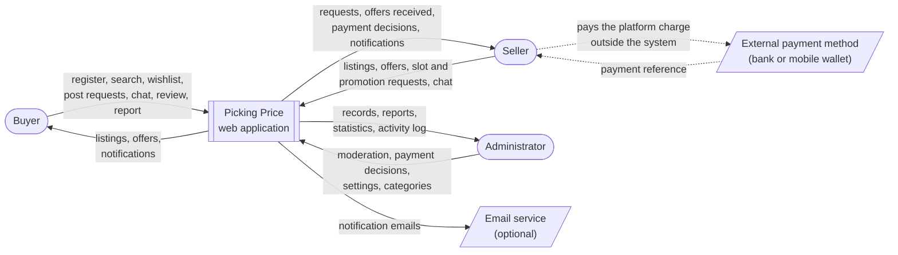
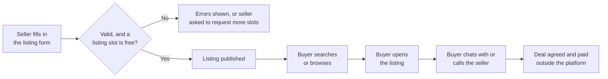
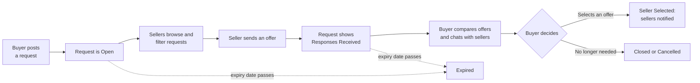
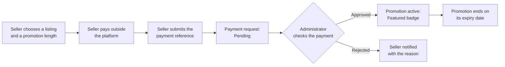
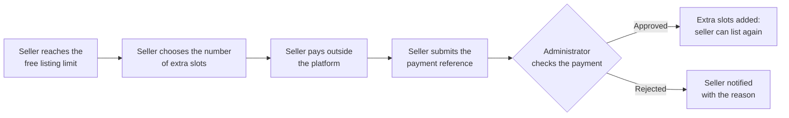
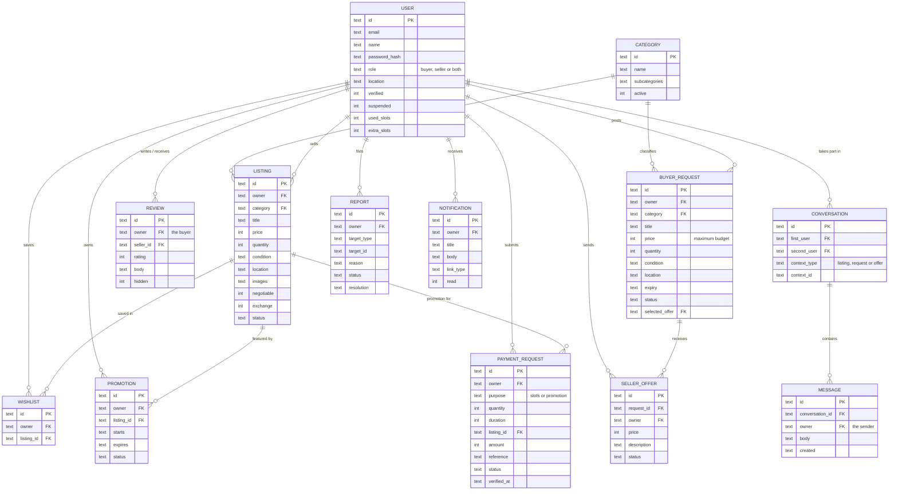
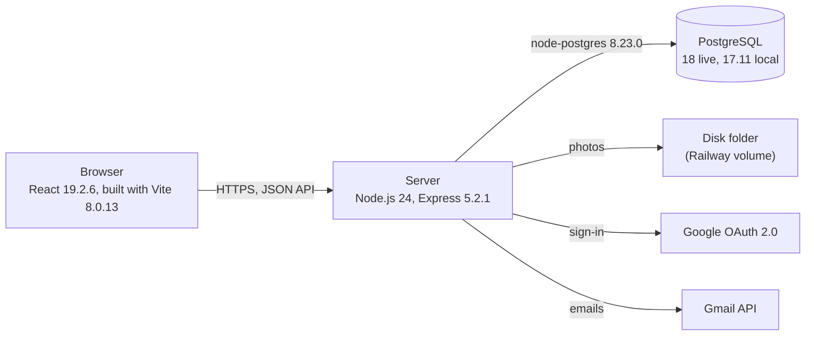

# Picking Price Analysis Models

These models describe the system as it is implemented. They correspond to Appendix B of the Software Requirements Specification: the context model (B.1), the core marketplace flows (B.2) and the entity-relationship diagram (B.3).

Image versions of every diagram are in `docs/diagrams/`.

## 1. Context model

The system has three kinds of user and two external services. Product payments between buyer and seller never pass through the system.

| Actor | Interaction with Picking Price |
|---|---|
| Buyer | Registers and signs in, searches and filters listings, keeps a wishlist, posts requests, compares offers and selects a seller, chats with sellers, writes reviews, reports content |
| Seller | Registers and signs in, creates and manages listings, answers buyer requests with offers, chats with buyers, requests extra listing slots and promotions |
| Administrator | Manages members, listings, requests, reviews and categories, reviews reports, approves or rejects platform payments, sets limits and prices |
| Email service (optional) | Delivers a copy of each in-app notification when an email key is configured |
| External payment method | Receives the platform charge outside the system; the seller enters the payment reference for the administrator to verify |

## 2. Core marketplace flows

### 2.1 Fixed-price listing

### 2.2 On-demand request

### 2.3 Promotion

### 2.4 Additional listing slots

## 3. Entity-relationship diagram

The diagram covers the twelve entities listed in section 6.1 of the specification, as implemented. There are no order, auction, bid, wallet or withdrawal entities, because those functions are outside the project's scope.

### Notes on the implementation

| Entity in the specification | Table or tables |
|---|---|
| Users | `accounts` (sign-in details) and `profiles` (public details, role, listing slots) |
| Product Listings | `listings` |
| Categories | `categories` |
| On-Demand Requests | `buyer_requests` (unfinished ones in `request_drafts`) |
| Seller Responses | `seller_offers` |
| Wishlist | `favorites` |
| Reviews | `reviews` |
| Promotions | `promotions` |
| Payment Records | `payment_requests` |
| Messages | `conversations` and `chat_messages` |
| Reports | `reports` |
| Notifications | `notifications` |

Supporting tables that are not marketplace entities: `sessions`, `auth_attempts`, `oauth_states`, `uploads`, `settings`, `conversation_reads`, `admin_auth`, `admin_sessions`, `admin_audit`, `mail_account`, `notification_emails` and `schema_migrations`.

A listing or request stores its category by name; renaming a category in the admin panel updates the items that use it. A report points at its target (listing, request, message, review or member) through `target_type` and `target_id`.

## 4. System architecture

| Layer | Technology |
|---|---|
| Browser app | React 19.2.6, Vite 8.0.13, Tailwind CSS 4.2.1, Radix UI 1.6.7 |
| Server | Node.js 24, Express 5.2.1, Zod 3.25.76 |
| Data | PostgreSQL (18 on Railway, 17.11 locally), node-postgres 8.23.0 |
| Hosting | Railway (Docker image `node:24-slim`), source on GitHub |
| Outside services | Google OAuth 2.0 for sign-in, Gmail API for email |

Versions checked on 16 October 2026 against the installed packages and the live services.
